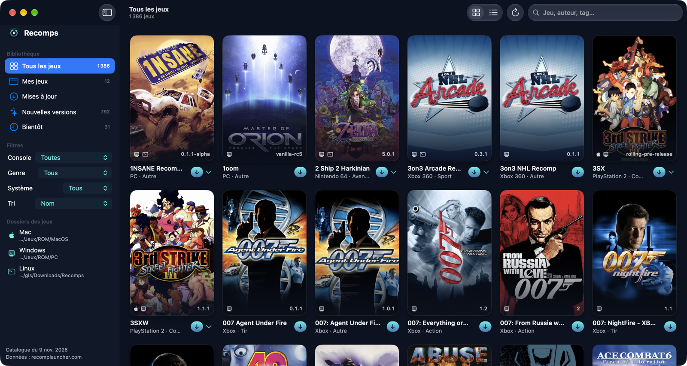

# Recomps

Petite app macOS (SwiftUI) pour parcourir, télécharger et tenir à jour les recomps PC (jeux console recompilés en natif pour Windows, Mac et Linux) listés sur [recomplauncher.com](https://recomplauncher.com/all).



- **Recherche** sur le nom, le jeu d'origine, l'auteur et les tags ; **filtres** par console, genre et système (Windows, Mac, Linux) ; tri par nom, dernière version, ajout au catalogue ou popularité. Grille de jaquettes ou liste.
- **Téléchargement rapide** depuis la grille ou la liste (bouton sous chaque jeu, menu ⌄ pour les autres systèmes), ou depuis la fiche du jeu. Fichiers pris dans les releases GitHub ou GitLab de chaque projet, avec vérification SHA-256 quand le catalogue la donne, et confirmation si l'analyse antivirus du site a signalé le fichier.
- **Un dossier par système** (par exemple Mac → `ROM/MacOS`, Windows → `ROM/PC`). Pour Mac, l'app est sortie de son archive (`.zip`, `.dmg`, `.tar.gz`) et posée directement dans le dossier.
- **État de chaque jeu** : à jour, mise à jour disponible, ou présent. L'app reconnaît ce qu'elle a téléchargé, les archives dont le nom suit le modèle du catalogue, et les `.app` déjà installées (nom, bundle ID, version de l'app).
- **Tout mettre à jour** en un clic : les jeux marqués « Mise à jour » sont téléchargés l'un après l'autre ; l'ancienne version va à la corbeille.
- **Notes de version** de chaque jeu (releases GitHub ou GitLab), avec les versions sorties depuis la tienne marquées « nouveau ». Projets arrêtés, en pause ou archivés signalés sur leur fiche, avec un lien pour signaler un problème.
- Bibliothèque : Tous les jeux, Mes jeux, Mises à jour, Nouvelles versions (14 derniers jours), Bientôt.

## Installation

Télécharger `Recomps-<version>.zip` dans les [releases](https://github.com/VGioM/Recomps/releases), le décompresser et placer `Recomps.app` dans Applications. L'app est signée ad hoc : au premier lancement, clic droit → Ouvrir.

Ensuite, en bas de la barre latérale, choisir le dossier de chaque système (clic sur le dossier ; clic droit pour l'afficher dans le Finder).

macOS 14 ou plus, Mac Apple Silicon.

## Utilisation

- Un clic sur une jaquette ouvre sa fiche à droite ; un clic dans le vide ou Échap la ferme.
- **⌘R** ou la flèche de la barre d'outils : recharge le catalogue, relit les dossiers et les notes de version.
- Il faut ta propre copie du jeu d'origine (indiquée sur chaque fiche).

## Fonctionnement

- Catalogue : `https://recomplauncher.com/pc-catalog.json`, le fichier que le site lit lui-même, gardé en cache dans `~/Library/Application Support/Recomps/` et rechargé seulement s'il a changé (ETag).
- Fichiers : `github.com/<dépôt>/releases/download/<tag>/<fichier>` quand le catalogue nomme le fichier ; sinon le modèle du catalogue (`Nom-*-macOS.zip`) est cherché dans la release via l'API GitHub. Notes de version : API GitHub, gardées 6 h. Sans compte, GitHub autorise 60 requêtes par heure.
- Jeux déjà là : l'app parcourt le dossier de chaque système sur 3 niveaux. Une version lue dans le nom du fichier (ou dans l'app) est comparée à la dernière ; sinon, la date du fichier est comparée à celle de la release.
- Ce que l'app a téléchargé est noté dans `installed.json` (même dossier).

## Compiler

```sh
./build.sh          # dist/Recomps.app
./build.sh install  # et copie dans /Applications
```

Swift 5.9+ (Xcode ou Command Line Tools). `App/make_icon.swift` dessine l'icône.

Recomps n'est pas affilié à recomplauncher.com ni aux projets listés : il lit leur catalogue public et télécharge depuis les dépôts GitHub de chaque projet.
